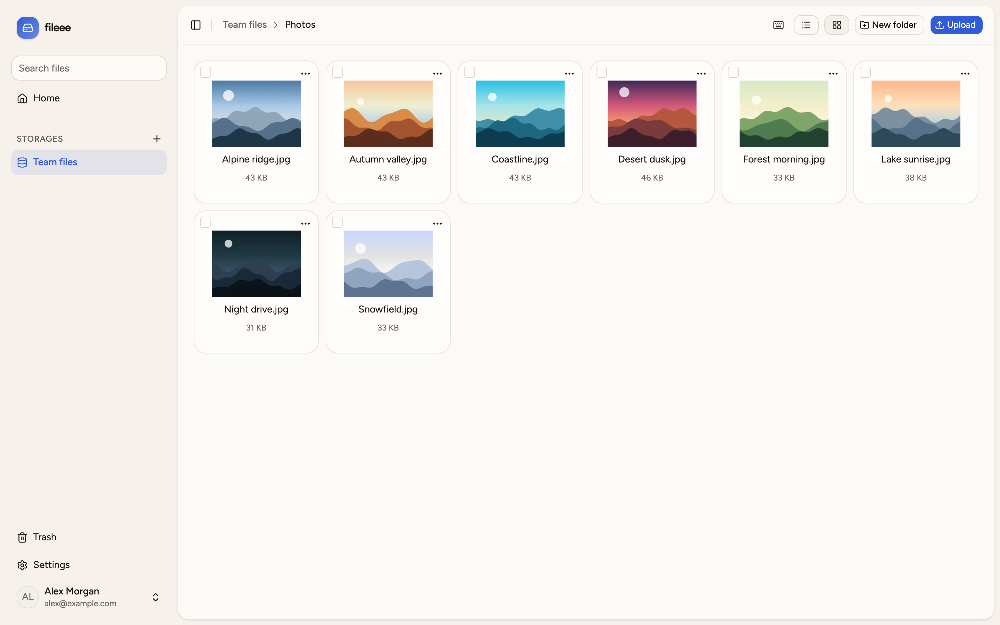
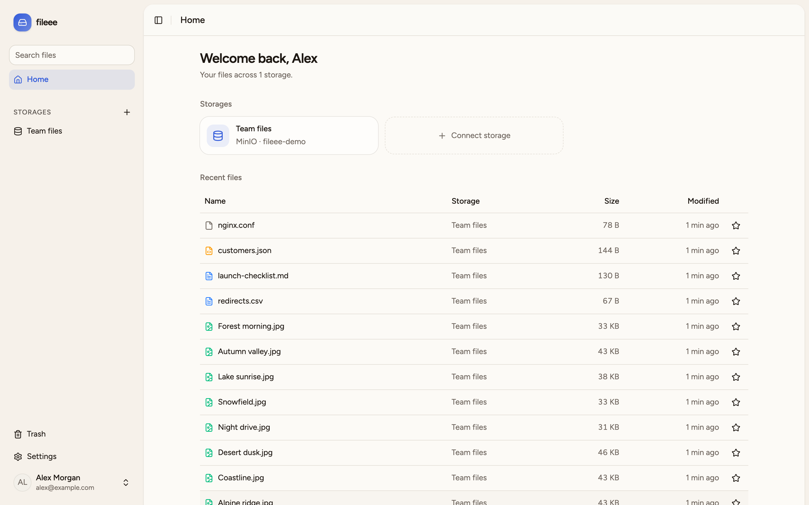
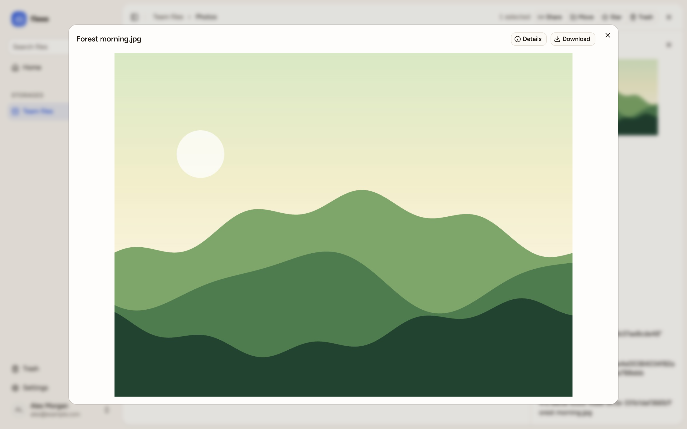
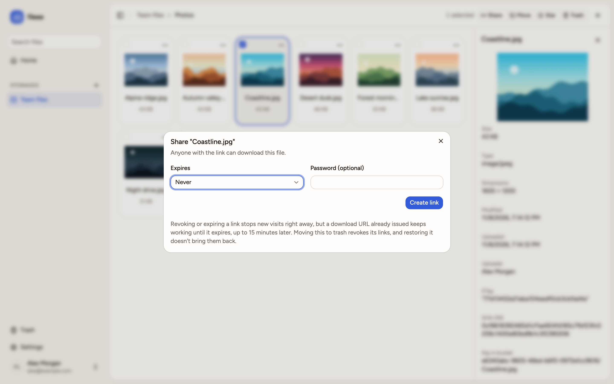

<p align="center">
  
</p>

<h1 align="center">fileee</h1>

A self-hosted, Google Drive-style file manager. Your files stay in S3-compatible storage you own (AWS S3, Cloudflare R2, Backblaze B2, MinIO and others). fileee keeps only metadata and encrypted credentials, and browsers upload and download directly from the bucket.

<picture>
  <source media="(prefers-color-scheme: dark)" srcset="apps/docs/public/screenshots/browser-dark.png">
  
</picture>

<table>
  <tr>
    <td></td>
    <td></td>
    <td></td>
  </tr>
</table>

## Quick start

```bash
cat > .env <<EOF
APP_URL=http://localhost:3000
ENCRYPTION_KEY=$(openssl rand -base64 32)
SETUP_TOKEN=$(openssl rand -hex 16)
POSTGRES_PASSWORD=$(openssl rand -hex 24)
EOF
docker compose up -d --build
```

Visit `APP_URL`, complete the setup page, and connect a bucket in settings. On a public address, read [Deploying](apps/docs/src/content/docs/deploying.md) first: until setup is complete, whoever reaches the instance first becomes admin.

## Documentation

- [Installing](apps/docs/src/content/docs/installing.md): Docker or from source, first-run setup, connecting a bucket
- [Deploying](apps/docs/src/content/docs/deploying.md): configuration, HTTPS, upgrades, backups, recovery, public CDN links
- [How it works](apps/docs/src/content/docs/how-it-works.md): where data lives, uploads, sync, trash, sharing, background jobs
- [Security](apps/docs/src/content/docs/security.md): what's protected, what isn't, and a pre-launch checklist
- [Troubleshooting](apps/docs/src/content/docs/troubleshooting.md): common errors and their fixes
- [Developing](apps/docs/src/content/docs/developing.md): local setup, tests, migrations
- [AGENTS.md](AGENTS.md): architecture and code conventions
