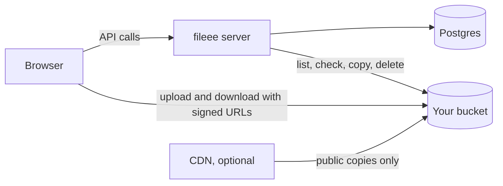

# How it works

fileee is an index and a set of permissions over buckets you already own. The server decides who may do what and signs short-lived URLs. File bytes go straight between the browser and the bucket.

## What lives where

|                       | Owner    | Notes                                                  |
| --------------------- | -------- | ------------------------------------------------------ |
| File bytes            | Bucket   | Never pass through the server                          |
| Size, ETag            | Bucket   | Read from the provider, never trusted from the browser |
| Whether a file exists | Bucket   | If the database disagrees, the bucket wins             |
| Names, folders        | Database | A rename or move is one row, however large the folder  |
| Stars, trash, shares  | Database |                                                        |
| Users, sessions       | Database |                                                        |
| Bucket credentials    | Database | Encrypted with `ENCRYPTION_KEY`                        |

The code is split the same way: `apps/web` is the interface and HTTP entry point, `packages/api` holds every procedure, `packages/db` the schema, and `packages/storage` everything that talks S3.

## Folders and object keys

Folders exist only in the database, so the bucket's layout won't match what you see in the app.

- An uploaded file is stored at `<prefix>/<fileId>/<original name>`. That key never changes, and downloads use the file's current name.
- A file found by sync keeps the key it already had.
- fileee's own objects sit under `<prefix>/.fileee/`: thumbnails, connection probes and, by default, public copies.

## Uploads

1. The browser asks the server to start an upload. The server creates a `pending` file row and signs a URL.
2. The browser uploads directly to the bucket, up to three files at a time. Files of 16 MiB or more use multipart, four parts at a time, each retried up to three times. The limit is 5 TiB per file.
3. The browser reports completion. The server finishes any multipart upload, asks the bucket for the real size and ETag, and only then makes the file visible.
4. The browser makes the thumbnail and extracts metadata such as EXIF or PDF page count, then saves them. A failure here costs only a thumbnail.

An interrupted multipart upload can be resumed by picking the same file again, for up to 7 days. After that, or for an abandoned single upload, cleanup aborts it so unfinished parts stop being billed. If a single upload's bytes did arrive and only the final call was lost, cleanup completes it.

## Previews

Previews load from the bucket with URLs that last 15 minutes. The server picks how a file is previewed, and the content type it's served with, from the file name alone.

| Type            | How it's shown                      |
| --------------- | ----------------------------------- |
| Images          | ``                             |
| Video and audio | Native player, using range requests |
| PDF             | pdf.js                              |
| Text and code   | Rendered as text, first 1 MiB       |
| Anything else   | Download                            |

Imported files have no thumbnail until you run the **Backfill thumbnails** action on a storage, which does the work in your browser.

## Sync

Sync makes the index match the bucket. It runs when a storage is connected, on **Sync now**, and daily. Each storage runs one sync at a time, and a sync interrupted by a restart continues where it left off. A sync still running after 6 hours is stopped and marked failed.

| Found                        | Result                                                  |
| ---------------------------- | ------------------------------------------------------- |
| Object with no row           | New file, with folders made from the `/` in its key     |
| Size or ETag changed         | Row updated, and the old thumbnail and metadata cleared |
| Row with no object           | File marked `missing`, keeping the row                  |
| `missing` file's key is back | File marked ready again                                 |

Sync never changes or deletes your files, and it never overwrites renames, moves, stars or trash state. Files are only marked `missing` after a complete listing, so an expired credential can't empty your library. It also skips `.fileee/` and the public location.

Files are matched by key, so renaming an object outside fileee shows up as one `missing` file and one new file.

After a database loss, objects in fileee's own `<fileId>/<name>` layout come back in a folder called **Recovered**.

## Trash and deletion

Trash is a flag: nothing leaves the bucket, and items stay until someone restores or purges them. There's no automatic expiry.

Trashing revokes the item's share links and removes its public copy. Restoring brings the item back but not those.

Purging marks the rows and hands them to a background job, which deletes the object first and the row second, so a failure just retries. Removing a storage or user is different: fileee forgets the connection and index but leaves your files in the bucket. Only its public copies are deleted.

## Sharing

|                  | Private link                                                             | Public CDN link                    |
| ---------------- | ------------------------------------------------------------------------ | ---------------------------------- |
| Address          | `APP_URL/share/<token>`                                                  | Your CDN's domain                  |
| Applies to       | Files and folders                                                        | Files                              |
| Password, expiry | Optional                                                                 | None                               |
| Download count   | Yes                                                                      | No                                 |
| Revoking         | New visits stop at once. A URL already signed works for up to 15 minutes | Stops when the CDN's cache expires |
| Storage          | No extra                                                                 | A second copy in the bucket        |

A signed URL is tied to the bucket's host, and a CDN that can read a bucket serves anyone who asks. So publishing copies the file to a separate public location the CDN is limited to, under a random token, and private files never use the CDN. Publishing the file again creates a new token, so an old URL never comes back. The public copy doesn't follow later changes to the original.

## Search

Search uses Postgres full-text search over file names plus the title, author and camera from extracted metadata. It matches prefixes, and every term must match. A generated column on the `file` table keeps the index current.

## Background work

Work runs inside the server process, with no queue service. The `job` table holds three types: `sync`, `purge` and `unpublish`.

- Three workers run jobs, and syncs use at most two of them. Only one job runs per storage at a time, except that removing public copies doesn't wait for a long sync.
- A running job holds a two-minute lease it keeps renewing. If a restart cuts it off, the lease runs out and the job is picked up again.
- A failed purge or unpublish retries with backoff, from one minute up to one hour. A failed sync records its error and waits for the next schedule or **Sync now**.
- Every 15 minutes, housekeeping clears expired uploads, sessions and rate-limit rows, and queues due syncs.

This is why an instance can't have replicas: timers and job workers run inside the one server process.

## Users

The first account is the admin, who creates other accounts in **Settings > Users**. Each user connects their own storages and sees only those. An admin manages accounts but can't open another user's files.

See [Security](security.md) for how this is enforced.
